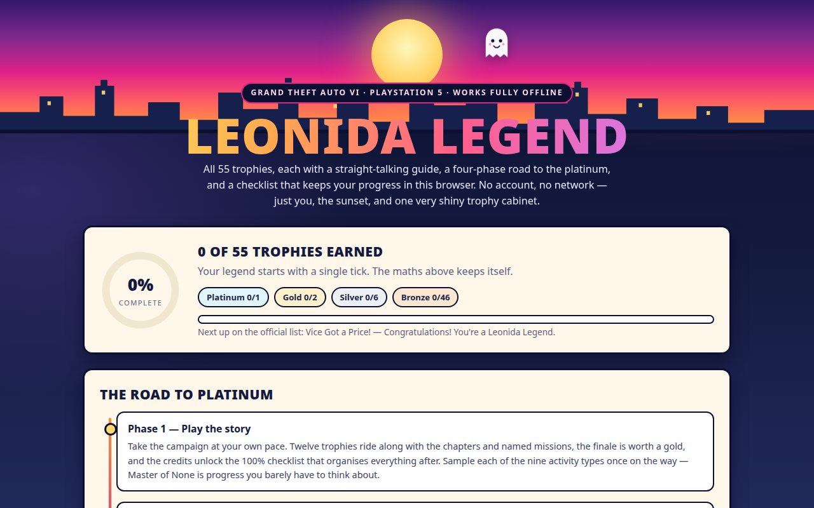

[](https://make.fun/bounty/gta6-trophy-guide-01?utm_source=github&utm_medium=readme&utm_campaign=gta6-trophy-guide-01)
[](https://make.fun/bounty/gta6-trophy-guide-01/leaderboard?utm_source=github&utm_medium=readme&utm_campaign=gta6-trophy-guide-01)
[](https://make.fun/bounty/gta6-trophy-guide-01?utm_source=github&utm_medium=readme&utm_campaign=gta6-trophy-guide-01)

# Leonida Legend — GTA VI Trophy Guide & Tracker

An entry for the make.fun bounty [Build the best GTA 6 trophy guide](https://make.fun/bounty/gta6-trophy-guide-01).

A complete, offline web app that walks a player to the Grand Theft Auto VI
platinum: all **55 PlayStation 5 trophies** with their official names,
descriptions and grades, an original how-to guide written for every single one,
and a checklist that lives in the browser. Open `app/index.html` and it works —
no build step, no server, no network.



## What is inside

- **The full official list, verified.** 55 trophies — 1 platinum, 2 gold,
  6 silver, 46 bronze — cross-checked on 20 November 2026 against the published
  lists at Push Square, KeenGamer, GamesFuze and AlcastHQ. One of those guides
  lists Maximum Withdrawal as bronze; it is silver, and this guide follows the
  official list. Where the community has not confirmed a hidden trophy's unlock
  method yet, the entry says so honestly instead of inventing one.
- **A guide for every trophy**, written for this project: the counters
  (250 of 397 stunts, 42 shooting-range golds, 100 WAiNK scans), the strand
  finales, the partner crime trophies, and the eight garages of Little Boxes
  with their prices added up ($160,000 in total).
- **A four-phase roadmap** to the platinum — story first, strands second,
  counters and collections third, the 100% lap last — with an honest missables
  note: nothing on the list is permanently missable, and the one choice-linked
  trophy is flagged with the save habit that covers it.
- **A working tracker**: tick trophies off and progress persists in
  localStorage; a dashboard shows a completion ring, a progress bar, per-grade
  counts and the next trophy on the official list.
- **Filters by grade and kind** (story, side strands, activities, world &
  collectibles, crime, money, secrets, completion), full-text search, a status
  filter and four sort orders.
- **A spoiler shield**: the 18 story and secret trophies start blurred — name,
  description and guide hidden — until revealed one by one or all at once.
- **Export / import** of your progress as a small JSON file, plus a reset.

## Run it

The entry program (Node 22, standard library only) delivers the app and its
dossier to the output directory:

```sh
mkdir -p out && MAKEFUN_OUTPUT_DIR=out node main.ts
```

To preview the guide while developing:

```sh
node serve.ts   # then open http://localhost:8080
```

## Layout

- `app/` — the guide itself: `index.html`, `style.css`, `app.js`, and
  `data/trophies.json` (the verified trophy list with guides).
- `main.ts` — the delivery program; copies `app/` and `screenshots/` to the
  output directory and writes `dossier.json` via the vendored library.
- `vendor/makefun-frontend.ts` — the make.fun kit library, kept byte-for-byte
  as shipped, as the scorer requires.
- `screenshots/` — four views of the running app (see `shots.json`).
- `serve.ts` — a tiny local preview server for `app/`.

## Data sources

Push Square, *GTA 6: Trophy Guide & Roadmap* (18 Nov 2026); KeenGamer,
*GTA 6 Trophy Guide & Platinum Roadmap*; GamesFuze, *GTA 6 Trophy List:
All 55 Trophies & Achievements*; AlcastHQ, *GTA 6 Trophy List*. Trophy names,
descriptions and grades are factual data from the official list; all guide
text, code and design in this repository are original work for this entry.

Unofficial fan project — not affiliated with Rockstar Games, Take-Two
Interactive or Sony. Licensed under the MIT License (see `LICENSE`).
